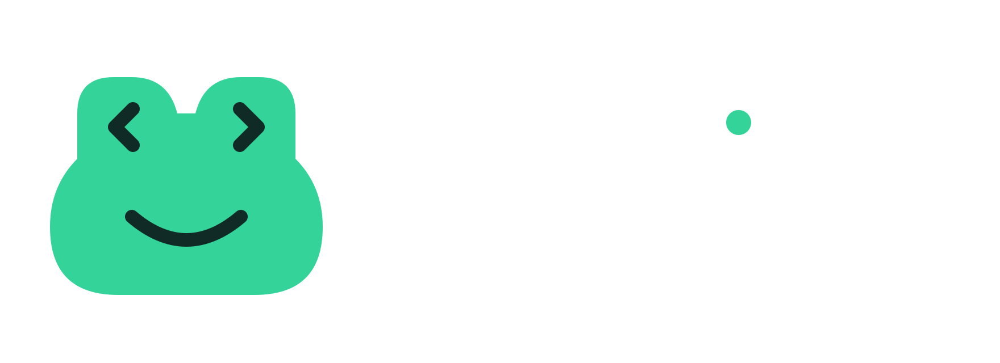

## FRGLib


Rust-обвязка над SDL3: окно, рендерер и обработка событий. Слой для Vulkan
впереди.

## Требования

- Rust 1.82+
- SDL3 (для сборки по умолчанию берётся системная библиотека)
- `cmake` и C-компилятор — только если включаешь фичу `bundled`

## Сборка и запуск

```bash
cargo build
cargo run --example basic-window
```


<h2>
  
  Использование
</h2>

```rust
use frglib::{Color, Event, Window};
use std::time::Duration;

fn main() -> Result<(), frglib::Error> {
    let mut window = Window::builder("FRGLib")
        .size(800, 600)
        .resizable(true)
        .vulkan(false)
        .background(Color::GREEN)
        .build()?;

    loop {
        for event in window.poll()? {
            match event {
                Event::Quit | Event::CloseRequested => return Ok(()),
                Event::Resized { width, height } => println!("{width}x{height}"),
                _ => {}
            }
        }

        window.frame()?;
        std::thread::sleep(Duration::from_millis(16));
    }
}
```

## API

| Вызов | Описание |
|---|---|
| `Window::builder(title)` | Начинает сборку окна. Заголовок обязателен, остальное необязательно |
| `.size(w, h)` | Размер в пикселях. По умолчанию 800x600 |
| `.resizable(bool)` | Разрешить ресайз. По умолчанию `true` |
| `.vulkan(bool)` | Флаг `SDL_WINDOW_VULKAN`. По умолчанию `false` |
| `.background(Color)` | Цвет фона. По умолчанию `Color::GREEN` |
| `.build()` | Открывает окно, возвращает `Result<Window, Error>` |
| `poll() -> Result<Vec<Event>, Error>` | Разбирает очередь событий за кадр |
| `frame() -> Result<(), Error>` | Заливает окно текущим цветом и показывает кадр |
| `frame_with(impl FnOnce(&mut Draw) -> Result<(), Error>)` | То же, но позволяет рисовать поверх фона |
| `set_background(Color)` | Меняет цвет фона на лету |
| `background() -> Color` | Текущий цвет фона |
| `size() -> (u32, u32)` | Текущий размер окна |
| `vulkan_instance_extensions() -> Result<Vec<String>, Error>` | Расширения Vulkan, нужные этому окну |

`Event::should_close()` отвечает на вопрос, стоит ли продолжать цикл.

### Рисование

`frame_with` очищает окно фоном, зовёт твой код, показывает кадр:

```rust
window.frame_with(|d| {
    d.fill_square(100.0, 100.0, 200.0, Color::rgb(220, 60, 60))?;
    Ok(())
})?;
```

| Вызов | Описание |
|---|---|
| `fill_rect(rect, Color)` | Заливает прямоугольник сплошным цветом |
| `fill_square(x, y, side, Color)` | Квадрат с левым верхним углом в `(x, y)` |
| `fill_square_centered(cx, cy, side, Color)` | Квадрат с центром в `(cx, cy)` |
| `fill_texture(rect, &Image)` | Заливает прямоугольник текстурой |
| `fill_textured_square(x, y, side, &Image)` | Квадрат с текстурой |
| `fill_polygon(points, indices, Color)` | Заливает многоугольник по списку треугольников |
| `draw_polygon(points, Color)` | Обводит многоугольник отрезками |
| `fill_textured_polygon(points, indices, &Image)` | Заливает многоугольник текстурой |
| `size()` | Размер окна, полезно для центрирования |

Альфа работает сама: цвет с `a < 255` смешивается с тем, что под ним, с `a == 255`
затирает. Режим проходимости переключается сам, только когда он реально меняется.

### Текстуры

```rust
let logo = Image::from_file("assets/logo.png")?;

window.frame_with(|d| {
    d.fill_textured_square(100.0, 100.0, 200.0, &logo)?;
    Ok(())
})?;
```

`Image` держит пиксели в памяти CPU и ничего не занимает у окна, так что может
жить дольше него. SDL сам определяет PNG и BMP; остальные форматы требуют
сборки SDL с соответствующей библиотекой.

Текстура заливается на GPU **на каждый вызов** и сразу удаляется, то есть
стоимость — одна загрузка на кадр. Для спрайтов это нормально, для крупной
картинки в цикле будет заметно — тогда понадобится постоянная текстура.

`fill_textured_polygon` растягивает текстуру по bounding box многоугольника, так
что полигон закрывает её целиком, а пропорции картинки не сохраняются.

### Примеры

| Пример | Что показывает |
|---|---|
| `cargo run --example basic-window` | Окно, ввод, события |
| `cargo run --example basic-draw` | Прямоугольники, квадраты, альфа |
| `cargo run --example basic-texture` | Логотип библиотеки как текстура |
| `cargo run --example basic-polygon` | Многоугольники: заливка, контур, текстура |
| `cargo run --example basic-mouse` | Состояние кнопок мыши: `Down`/`Up`, потеря фокуса |

### События

`poll()` возвращает `Vec<Event>`: `Quit`, `CloseRequested`, `Resized`, `Moved`,
`FocusGained`/`FocusLost`, `Minimized`/`Maximized`/`Restored`, `KeyDown`,
`KeyUp`, `TextInput`, `MouseMotion`, `MouseButtonDown`, `MouseButtonUp`,
`MouseWheel`.

У SDL одна очередь событий на весь процесс, поэтому события фильтруются по
идентификатору окна: чужое окно не получит твои события мыши и клавиатуры.
Исключение — `Event::Quit`, он не привязан к окну.

## SDL3 без зависимости от системы

По умолчанию линкуется системная SDL3. Фича `bundled` собирает её из исходников
и линкует статически — полезно, если итоговый бинарник должен таскать SDL3 с
собой:

```bash
cargo build --release --features bundled
```

Оговорка про `bundled`: в `sdl3-sys` флаг `build-from-source` сам по себе не
переключает линковку на статическую — за это отвечает отдельный `link-static`.
Нужен именно `build-from-source-static`, как и прописано в фиче.

## Ограничения

- SDL требует, чтобы окно создавалось и использовалось в том же потоке, который
  первым инициализировал SDL. `Window` не `Send` и не `Sync`, и рендерер
  создаётся только на главном потоке — так что `frame()` тоже оттуда.
- События ввода и клавиатуры не диспетчеризуются: `poll()` сообщает только о
  том, что окно закрывается, остальное выбрасывает. Это следующий шаг.
- `set_draw_color` и `clear` в крейте `sdl3` `panic!` вместо `Result`, так что
  битый рендерер вылезет паникой, а не `Error`. `present` ошибку возвращает
  честно, этот случай обработан.
